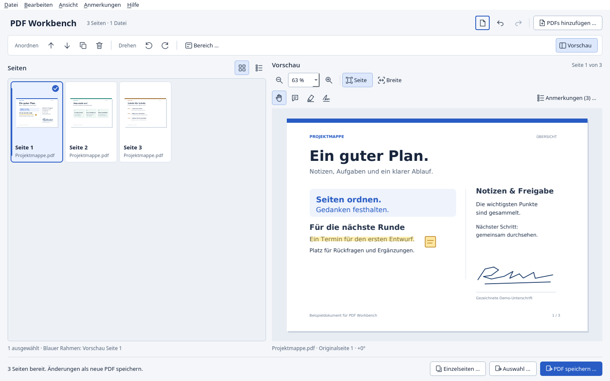

# PDF Workbench

PDFs zusammenfügen, Seiten sortieren und schnell etwas dazuschreiben.
PDF Workbench ist eine freie Desktop-App für Windows und Linux. Sie arbeitet
lokal, ohne Konto und ohne Upload deiner Dokumente.

Der Quellcode enthält den noch unveröffentlichten Entwicklungsstand **0.6.0**
mit neuer Oberfläche, Komprimierung, Passwortschutz und Formularausfüllung.
Die öffentlichen Downloads unten bleiben bei **0.5.3** und enthalten diese
Erweiterungen noch nicht.



## Download

| System | Download für v0.5.3 |
| --- | --- |
| Windows 64-Bit | [ZIP herunterladen](https://github.com/MGCrafter/pdf-workbench/releases/download/v0.5.3/PDFWorkbench-v0.5.3-windows-x86_64.zip) |
| Linux 64-Bit | [tar.gz herunterladen](https://github.com/MGCrafter/pdf-workbench/releases/download/v0.5.3/PDFWorkbench-v0.5.3-linux-x86_64.tar.gz) |

Alle Versionen, Prüfsummen und Hinweise zu den Paketen findest du unter
[Releases](https://github.com/MGCrafter/pdf-workbench/releases).
Quellen und Prüfberichte liegen gebündelt im
[getrennten Quellenarchiv](https://github.com/MGCrafter/pdf-workbench/releases/tag/source-archives).
macOS ist noch nicht getestet und hat derzeit kein Downloadpaket.

**Windows:** Das ZIP vollständig entpacken und im entpackten Ordner
`PDFWorkbench.exe` öffnen. Die mitgelieferten Dateien müssen im selben Ordner
bleiben.

**Linux:** Das Archiv entpacken und die App starten:

```sh
tar -xzf PDFWorkbench-v0.5.3-linux-x86_64.tar.gz
cd PDFWorkbench
./PDFWorkbench
```

Die fertigen Pakete enthalten Python und die benötigten Bibliotheken.
Du brauchst dafür keine eigene Python-Installation. Unterstützte und getestete
Linux-Distributionen stehen in den jeweiligen Release-Hinweisen.

## Was die App kann

- Mehrere PDFs in einer Datei zusammenfügen.
- Seiten sortieren, drehen, duplizieren oder entfernen.
- Eine Auswahl gemeinsam oder jede ausgewählte Seite einzeln speichern.
- Kommentare und Textmarkierungen hinzufügen, bearbeiten und löschen.
- Eine Unterschrift zeichnen und auf der Seite platzieren.
- Eigene Textfelder, Bilder, Stempel, Häkchen und Kreuze einfügen.
- Objekte auswählen, verschieben, vergrößern, kopieren und wieder bearbeiten.
- Nach Text suchen und PNG-/JPEG-Bilder in PDF-Seiten umwandeln.
- Scans mit optionalem Tesseract lokal durchsuchbar machen.
- Seiten als Miniaturen ansehen und in der Vorschau zoomen und verschieben.
- Helle oder dunkle Oberfläche; auf Wunsch passend zur Systemeinstellung.
- Ab 0.6: Komprimieren mit Größenvergleich, geschützte PDFs öffnen und mit
  AES-256 speichern, normale AcroForms ausfüllen.

## Loslegen

1. **PDFs hinzufügen …** anklicken oder Dateien ins Fenster ziehen.
2. Die gewünschten Seiten auswählen. Mit **Strg** und **Umschalt** kannst du
   mehrere auswählen; **Bereich …** versteht Angaben wie `1-3, 5, 8`.
3. Seiten mit der Maus oder den Pfeiltasten in der Werkzeugleiste anordnen.
   Drehen, Duplizieren und Entfernen wirken auf die Auswahl.
4. In der Vorschau Kommentare setzen, über Text ziehen, um ihn zu markieren,
   oder eine gezeichnete Unterschrift einfügen. Unter **Anmerkungen …** lassen
   sich diese Einträge später ändern oder löschen.
5. **PDF speichern …** speichert alle Seiten als neue PDF. **Auswahl …** speichert
   nur die ausgewählten Seiten; **Einzelseiten …** legt einzelne PDFs in einem
   neuen Unterordner an.

**Deine Originale bleiben unverändert.** Die App überschreibt auch keine
vorhandenen Ausgabedateien. Wähle zum Speichern einen neuen Dateinamen.
Eigene Anmerkungen bleiben nach dem Speichern und erneuten Öffnen bearbeitbar.

Neue Textfelder und Bilder findest du in der Vorschau unter **Einfügen**.
Mit dem Pfeilwerkzeug kannst du eigene Objekte auswählen und verschieben;
die Eckpunkte ändern ihre Größe. Ein Doppelklick öffnet die Eigenschaften.
**Strg + F** öffnet die Suche. **Datei → Bilder zu PDF-Seiten …** übernimmt Fotos
als neue Seiten; **Datei → Durchsuchbare PDF erstellen (OCR) …** startet die
optionale Texterkennung. Die [OCR-Anleitung](docs/ocr.md) erklärt die Einrichtung.

Der hervorgehobene Rahmen zeigt die Seite in der Vorschau, die Häkchen zeigen die
Auswahl für die Werkzeuge. Mehr zur Bedienung steht in der
[kurzen Anleitung](docs/usage.md).

Unter **Ansicht → Darstellung** wählst du **System**, **Hell** oder **Dunkel**.
Die Auswahl bleibt beim nächsten Start erhalten. Die PDF-Seiten behalten ihre
Originalfarben.

## Maus und Tastatur

| Aktion | Bedienung |
| --- | --- |
| Ansicht verschieben | Handwerkzeug und linke Maustaste; mittlere Maustaste in jedem Werkzeug |
| Horizontal scrollen | Seitliches Mausrad, Touchpad oder Umschalt + Mausrad |
| Zoomen | Strg + Mausrad oder Strg + `+` / `-` |
| Ganze Seite / Seitenbreite | Strg + `0` / Strg + `1` |
| Seiten verschieben | Alt + Pfeil hoch / runter |
| Links / rechts drehen | Strg + `L` / Strg + `R` |
| Duplizieren / entfernen | Strg + `D` / Entf |
| Rückgängig | Strg + `Z` |
| Text suchen | Strg + `F`; Eingabe / Umschalt + Eingabe zum nächsten / vorigen Treffer |
| Eigenes Objekt bearbeiten | Doppelklick, F2 oder Eingabe im Pfeilwerkzeug |
| Objekt verschieben / abbrechen | Pfeiltasten; Umschalt für größere Schritte / Esc |

## Grenzen

Die App richtet sich an normale Dokumentseiten. Gezeichnete Unterschriften
sind sichtbare Zeichnungen, keine kryptografischen Zertifikatssignaturen.

- PDFs mit Öffnungspasswort lassen sich entsperren und als neue Datei mit
  AES-256 schützen. Normale Exporte, Einzelseiten und OCR bleiben unverschlüsselt.
  Passwörter werden nicht in Einstellungen oder Dokument-Snapshots gespeichert.
- Normale AcroForms mit Textfeldern, Kontrollkästchen und Einfachauswahl werden
  unterstützt. XFA, Zertifikatssignaturen, Optionsschalter, Aktionsschaltflächen,
  Skripte, Berechnungen und mehrdeutige oder nicht seitengebundene Felder werden
  abgewiesen. Neue interaktive Formularfelder können noch nicht erstellt werden.
- Bildkomprimierung kann Details verlieren; spezielle Bildformate und Masken
  bleiben unverändert. Es gibt keine garantierte Größenersparnis.
- Textmarkierungen brauchen eine vorhandene Textschicht. Die optionale OCR kann
  sie für Scans ergänzen. Bestehender PDF-Text lässt sich nicht direkt ändern;
  neue Textfelder sind eigene Objekte.
- Dokumentweite Lesezeichen, Anhänge, Metadaten und Tags werden beim Export
  nicht übernommen. PDF/A-Konformität ist nicht garantiert.
- Vorhandene Seitenanmerkungen werden übernommen. Interne Verweise auf entfernte
  oder umsortierte Seiten sind nicht vollständig unterstützt.

Die Oberfläche ist derzeit auf Deutsch. Welche Plattformen und Funktionen
getestet werden, steht unter [Tests](docs/testing.md).

## Aus dem Quellcode starten

Benötigt wird Python 3.11 oder neuer. Die Installation übernimmt PyQt6, pypdf,
Pillow und cryptography. Im Projektordner:

**Linux:**

```sh
python3 -m venv .venv
.venv/bin/python -m pip install .
.venv/bin/python run-local.py
```

**Windows, PowerShell:**

```powershell
py -3 -m venv .venv
.\.venv\Scripts\python.exe -m pip install .
.\.venv\Scripts\python.exe run-local.py
```

Nach der Installation steht auch der Befehl `pdf-workbench` in der virtuellen
Umgebung zur Verfügung. PDF-Dateien können beim Start als Argumente mitgegeben
werden.

Für die Entwicklung:

```sh
python -m pip install '.[test,build]'
python -m unittest discover -s tests -v
python packaging/build.py
```

Hinweise zum [Bauen unter Linux](docs/build-linux.md) und zu den
[Tests](docs/testing.md) stehen in der Dokumentation.

## Fehler melden

Bei Problemen hilft ein [Issue](https://github.com/MGCrafter/pdf-workbench/issues)
mit Betriebssystem, App-Version und den Schritten zum Nachstellen. Bitte keine
vertraulichen PDFs hochladen; ein kleines Beispieldokument reicht meist aus.

## Lizenz

PDF Workbench steht unter [GPL-3.0-or-later](LICENSE).
Die Lizenzen von PyQt6, Qt, pypdf und weiteren mitgelieferten Komponenten stehen
in den [Drittanbieterhinweisen](THIRD_PARTY_NOTICES.md) und unter [licenses/](licenses/).
Das Projekt ist unabhängig von Adobe.
